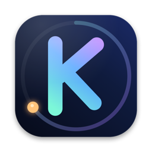
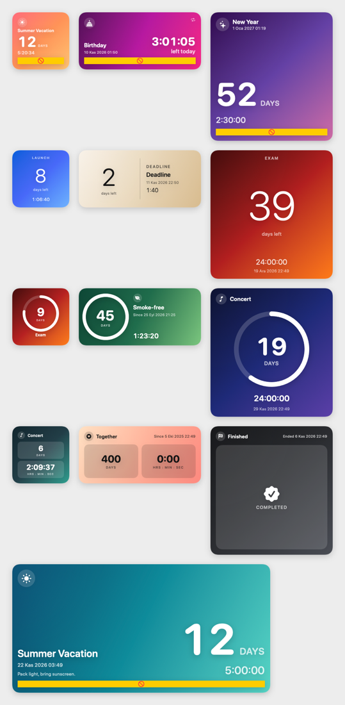

<p align="center">
  
</p>

<h1 align="center">Tempora</h1>

<p align="center">
  A beautiful, <b>fully local</b> countdown app for macOS with desktop widgets that tick down to the second — without draining your battery.
  <br>
  <a href="README.tr.md">Türkçe</a>
</p>

<p align="center">
  
</p>

*Tempora* is Latin for "times". Create a countdown for anything — a vacation, a birthday, a launch — and pin it to your desktop as a widget.

## Features

- **Desktop widgets** (WidgetKit): Small, Medium, Large and Extra Large, in four styles — *Poster*, *Minimal*, *Ring* and *Card* — plus an *Upcoming* list widget. Pick which countdown a widget shows from its context menu.
- **Down to the second, minimal battery.** The day count is static text; the hours:minutes:seconds part is drawn by macOS itself (`Text(timerInterval:)`), so neither the app nor the widget wakes up every second. Widget timelines only refresh at day boundaries.
- **Make it yours:** name, description, icon (SF Symbols, emoji or your own image), background (gradients, solid colors or your own photo with dim/blur) and an accent color for progress bars and rings (optionally tinting all text too).
- **Smart direction:** future dates count down, past dates count up. Repeating events always count down to the next occurrence. Choose whether an ended countdown shows *Completed* or *keeps counting up*.
- **Repeats:** daily, weekly (on chosen weekdays), monthly, yearly, "every N …", with an optional end date.
- **Notifications:** any number of reminders per countdown (at the time, 1 day before, custom…), scheduled as local notifications.
- **Menu bar item** with your next countdowns, **templates** (birthday, new year, exam, …), light & dark mode, Turkish and English UI.
- **100% local & private.** No account, no cloud sync, no analytics, no network requests. Data lives in a SwiftData (SQLite) store in the app group container on your Mac.

## Requirements

- macOS 26 or later
- Xcode 26 or later to build

## Build & run

```bash
git clone https://github.com/yunusemre-cagan/Tempora.git
cd Tempora
open Tempora.xcodeproj
```

The app and the widget share a database through an **App Group**, so the project must be signed with your own team:

1. In Xcode select the *Tempora* and *TemporaWidgetExtension* targets → **Signing & Capabilities** → choose your **Team**.
2. Change the bundle identifiers (`com.yunusemrecagan.Tempora` and `….Widget`) to your own.
3. Update the app group identifier in [`Shared/Store/AppGroup.swift`](Shared/Store/AppGroup.swift) to `<YOUR_TEAM_ID>.<your bundle id>` (it must match `$(TeamIdentifierPrefix)` + the bundle id in the `.entitlements` files).
4. Run the **Tempora** scheme.

To add a widget: right-click the desktop → **Edit Widgets…** → search for *Tempora* and drag one out. Right-click a placed widget → **Edit "Tempora"** to choose its countdown.

## Project layout

| Folder | Contents |
|---|---|
| `Shared/` | Code used by the app *and* the widget: SwiftData model, recurrence engine, time display logic, widget faces, localization |
| `Tempora/` | The app: library, editor, menu bar item, settings, notification scheduler |
| `TemporaWidget/` | The WidgetKit extension (configurable countdown widget + upcoming list) |
| `Config/` | Entitlements and the widget `Info.plist` |

## Packaging a DMG

```bash
scripts/make-dmg.sh
```

builds a universal (Apple Silicon + Intel) Release app and wraps it into `dist/Tempora-<version>.dmg` with a drag-to-Applications window.

Without a paid Apple Developer ID the DMG is signed with a development certificate and is **not notarized**, so macOS shows an "Apple could not verify…" warning on other Macs; users approve the app once in *System Settings → Privacy & Security → Open Anyway*. For a warning-free download, sign and notarize:

```bash
SIGN_IDENTITY="Developer ID Application: Your Name (TEAMID)" NOTARY_PROFILE=tempora-notary scripts/make-dmg.sh
```

(see the header of [`scripts/make-dmg.sh`](scripts/make-dmg.sh) for the one-time `notarytool` setup).

## License

[MIT](LICENSE)
