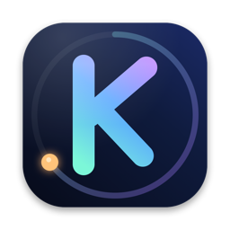
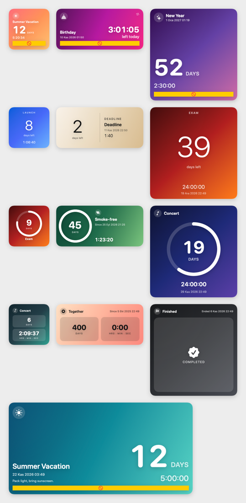

<p align="center">
  
</p>

<h1 align="center">Kalan</h1>

<p align="center">
  macOS için <b>tamamen local</b>, şık bir geri sayım uygulaması. Masaüstü widget'ları saniyesine kadar akar, pili yormaz.
  <br>
  <a href="README.md">English</a>
</p>

<p align="center">
  
</p>

*Kalan*, "geriye ne kaldı" demek. Tatil, doğum günü, lansman… her şey için bir geri sayım oluşturun ve masaüstünüze widget olarak sabitleyin.

## Özellikler

- **Masaüstü widget'ları** (WidgetKit): Küçük, Orta, Büyük ve Ekstra Büyük boyutlar; *Poster*, *Minimal*, *Halka* ve *Kart* stilleri ve bir *Yaklaşanlar* liste widget'ı. Widget'ın hangi geri sayımı göstereceğini sağ tık menüsünden seçersiniz.
- **Saniyesine kadar, minimum pil.** Gün sayısı sabit metindir; saat:dakika:saniye kısmını macOS kendisi çizer (`Text(timerInterval:)`). Ne uygulama ne widget saniyede bir uyanır. Widget timeline'ı yalnızca gün sınırlarında yenilenir.
- **Size özel:** isim, açıklama, ikon (SF Symbols, emoji ya da kendi görseliniz), arkaplan (degrade, düz renk ya da kendi fotoğrafınız; karartma/bulanıklık ayarlı) ve tüm metinleri boyayan vurgu rengi.
- **Akıllı yön:** gelecek tarih geri sayar, geçmiş tarih ileri sayar. Tekrarlayanlar her zaman bir sonraki tarihe sayar. Biten bir geri sayımın *Tamamlandı* mı göstereceğini yoksa *ileri saymaya devam* mı edeceğini seçebilirsiniz.
- **Tekrar:** günlük, haftalık (seçili günlerde), aylık, yıllık, "her N …"; isteğe bağlı bitiş tarihi.
- **Bildirimler:** her geri sayım için istediğiniz kadar hatırlatıcı (tam zamanında, 1 gün önce, özel…). Yerel bildirim olarak planlanır.
- **Menü çubuğu öğesi**, **şablonlar** (doğum günü, yılbaşı, sınav, …), açık/koyu tema, Türkçe ve İngilizce arayüz.
- **%100 local ve gizli.** Hesap, bulut senkronizasyonu, analitik ve ağ isteği yok. Veriler Mac'inizde, App Group klasöründeki bir SwiftData (SQLite) deposunda durur.

## Gereksinimler

- macOS 26 veya üstü
- Derlemek için Xcode 26 veya üstü

## Derleme ve çalıştırma

```bash
git clone https://github.com/yunusemre-cagan/Kalan.git
cd Kalan
open Countdown.xcodeproj
```

Uygulama ve widget veritabanını bir **App Group** üzerinden paylaşır, bu yüzden projeyi kendi geliştirici takımınızla imzalamanız gerekir:

1. Xcode'da *Countdown* ve *CountdownWidgetExtension* hedefleri → **Signing & Capabilities** → kendi **Team**'inizi seçin.
2. Bundle kimliklerini (`com.yunusemrecagan.Countdown` ve `….Widget`) kendinizinkilerle değiştirin.
3. [`Shared/Store/AppGroup.swift`](Shared/Store/AppGroup.swift) içindeki App Group kimliğini `<TEAM_ID>.<bundle id>` olacak şekilde güncelleyin (`.entitlements` dosyalarındaki `$(TeamIdentifierPrefix)` + bundle kimliğiyle aynı olmalı).
4. **Countdown** şemasını çalıştırın.

Widget eklemek için: masaüstüne sağ tıklayın → **Widget'ları Düzenle…** → *Kalan*'ı arayıp sürükleyin. Yerleştirdiğiniz widget'a sağ tıklayıp **"Kalan" Düzenle** ile geri sayımı seçin.

## Proje yapısı

| Klasör | İçerik |
|---|---|
| `Shared/` | Uygulama *ve* widget'ın ortak kodu: SwiftData modeli, tekrar motoru, zaman gösterimi, widget yüzleri, çeviriler |
| `Countdown/` | Uygulama: kütüphane, düzenleyici, menü çubuğu, ayarlar, bildirim planlayıcı |
| `CountdownWidget/` | WidgetKit eklentisi (seçilebilir geri sayım widget'ı + yaklaşanlar listesi) |
| `Config/` | Entitlement dosyaları ve widget `Info.plist` |

## Lisans

[MIT](LICENSE)
